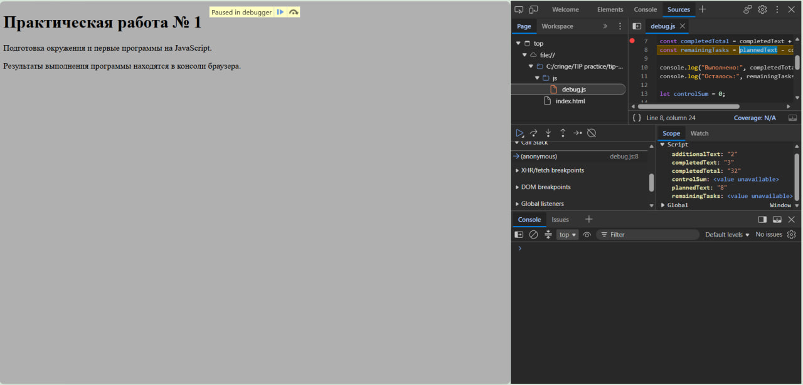

# Практическая работа № 1

**Тема:** Подготовка окружения и первые программы на JavaScript

## 1. Автор и вариант

**ФИО:** Филиппов К.А.  
**Группа:** ЭФБО-13-25
**Номер в журнале:** 26  
**Вариант:** 2

Для варианта 2 используются следующие значения:

- `totalTasks = 15`
- `completedTasks = 0`
- `dailyLimit = 4`

---

## 2. Окружение

Работа выполнялась в следующем окружении:

- Операционная система: Windows
- Node.js: v24.14.0
- npm: 11.9.0
- Git: 2.56.0.windows.1
- Редактор: Visual Studio Code
- Браузер: Edge

Для проверки установленных инструментов использовались команды:

```bash
node --version
npm --version
git --version
```

---

## 3. Запуск программ

Все команды выполнялись из корневой папки репозитория `tip-js-practices`.

```bash
node practice-01/js/hello.js
node practice-01/js/types.js
node practice-01/js/progress.js
node practice-01/js/plan.js
node practice-01/js/debug.js
```

Для запуска в браузере открывался файл `practice-01/index.html`.

Для проверки нужного задания в `index.html` изменялся путь подключаемого скрипта, например:

```html
<script src="./js/types.js" defer></script>
```

После сохранения файла страница перезагружалась, а результат проверялся во вкладке Console инструментов разработчика.

---

## 4. Задание 1. Один файл — две среды выполнения

Файл `hello.js` был запущен двумя способами: через Node.js и в браузере.

При запуске через Node.js результат выводился в терминал. Значение:

```text
Тип document: undefined
```

При запуске того же файла в браузере результат выводился во вкладку Console:

```text
Тип document: object
```

Различие связано со средой выполнения. В браузере существует объект `document`, предоставляющий доступ к HTML-документу. При обычном запуске JavaScript через Node.js HTML-документ отсутствует, поэтому `typeof document` возвращает `undefined`.

Сам `console.log()` не выводит результат непосредственно на HTML-страницу — результат отображается в консоли.

---

## 5. Задание 2. Исследование типов и преобразований

Были проверены десять выражений JavaScript. Перед запуском для каждого выражения был определён предполагаемый результат, после чего результат проверялся запуском программы.

| Выражение | Ожидание до запуска | Фактическое значение | Тип результата | Объяснение |
|---|---|---|---|---|
| `"8" + 2` | `"82"` | `"82"` | `string` | При использовании `+` со строкой число преобразуется в строку, после чего выполняется объединение строк. |
| `"8" - 2` | `6` | `6` | `number` | Оператор `-` выполняет числовое вычитание, поэтому строка `"8"` преобразуется в число. |
| `Number("8") + 2` | `10` | `10` | `number` | `Number("8")` явно преобразует строку в число `8`, после чего выполняется сложение. |
| `"12" > "3"` | `false` | `false` | `boolean` | Оба значения являются строками и сравниваются как строки. Первый символ `"1"` меньше `"3"`. |
| `12 === "12"` | `false` | `false` | `boolean` | Строгое равенство не выполняет автоматическое преобразование типов. |
| `Number("")` | `0` | `0` | `number` | Пустая строка при преобразовании через `Number()` становится числом `0`. |
| `Number("text")` | `NaN` | `NaN` | `number` | Строка `"text"` не является числом, поэтому получается `NaN`. При этом `typeof NaN` возвращает `"number"`. |
| `Boolean("false")` | `true` | `true` | `boolean` | Любая непустая строка преобразуется в `true`, независимо от её текстового содержимого. |
| `typeof null` | `"object"` | `"object"` | `string` | `typeof null` возвращает строку `"object"`. Тип самого результата выражения — `string`. |
| `typeof NaN` | `"number"` | `"number"` | `string` | `typeof NaN` возвращает строку `"number"`, поэтому тип самого результата — `string`. |

Файл `types.js` был проверен как через Node.js, так и в консоли браузера.

---

## 6. Задание 3. Сводка выполнения задач

Программа `progress.js` вычисляет количество оставшихся задач, процент выполнения и текущий статус.

Также выполняется проверка корректности входных данных: значения должны быть конечными целыми числами в допустимом диапазоне.

### Проверки

| Проверка | Входные данные | Ожидаемый результат | Фактический результат | Итог |
|---|---|---|---|---|
| Обычный случай | `12, 5` | Осталось 7; 41.7%; «В работе» | Осталось 7; 41.7%; «В работе» | Пройдено |
| Нет задач | `0, 0` | «Задач пока нет» | «Задач пока нет» | Пройдено |
| Работа не начата | `5, 0` | Осталось 5; 0.0%; «Не начато» | Осталось 5; 0.0%; «Не начато» | Пройдено |
| Все выполнено | `5, 5` | Осталось 0; 100.0%; «Завершено» | Осталось 0; 100.0%; «Завершено» | Пройдено |
| Выполнено больше существующих | `5, 6` | Ошибка | Ошибка | Пройдено |
| Отрицательное количество | `-1, 0` | Ошибка | Ошибка | Пройдено |
| Дробное количество | `5, 2.5` | Ошибка | Ошибка | Пройдено |
| Строка вместо числа | `"5", 2` | Ошибка | Ошибка | Пройдено |
| Превышение верхней границы | `1001, 0` | Ошибка | Ошибка | Пройдено |
| Значение `NaN` | `NaN, 0` | Ошибка | Ошибка | Пройдено |
| Индивидуальный вариант №2 | `15, 0` | Осталось 15; 0.0%; «Не начато» | Осталось 15; 0.0%; «Не начато» | Пройдено |

### Результат индивидуального варианта

Для варианта 2:

```text
Всего задач: 15
Выполнено: 0
Осталось: 15
Прогресс: 0.0%
Статус: Не начато
```

Случай `0, 0` обрабатывается отдельно, поэтому деления на ноль не происходит.

---

## 7. Задание 4. План выполнения задач по дням

В программе `plan.js` используется цикл `while`, который моделирует выполнение оставшихся задач по дням.

Количество выполняемых за день задач ограничено значением `dailyLimit`. Для последнего дня используется меньшее значение из дневного лимита и количества оставшихся задач.

### Проверки

| Проверка | Входные данные `totalTasks, completedTasks, dailyLimit` | Ожидаемый результат | Фактический результат | Итог |
|---|---|---|---|---|
| Обычный случай | `12, 5, 3` | 3 дня; последний день — 1 задача | 3 дня; последний день — 1 задача | Пройдено |
| Ровное распределение | `10, 4, 3` | 2 дня по 3 задачи | 2 дня по 3 задачи | Пройдено |
| Лимит больше остатка | `5, 3, 10` | 1 день; выполнено 2 задачи | 1 день; выполнено 2 задачи | Пройдено |
| Все задачи выполнены | `5, 5, 2` | 0 дней | 0 дней | Пройдено |
| Задач нет | `0, 0, 2` | 0 дней | 0 дней | Пройдено |
| Нулевой дневной лимит | `5, 2, 0` | Ошибка | Ошибка | Пройдено |
| Дробный дневной лимит | `5, 2, 1.5` | Ошибка | Ошибка | Пройдено |
| Выполнено больше существующих | `5, 6, 2` | Ошибка | Ошибка | Пройдено |
| Лимит задан строкой | `5, 2, "2"` | Ошибка | Ошибка | Пройдено |
| Лимит превышает 1000 | `5, 2, 1001` | Ошибка | Ошибка | Пройдено |
| Индивидуальный вариант №2 | `15, 0, 4` | 4 дня; в последний день 3 задачи | 4 дня; в последний день 3 задачи | Пройдено |

### Результат индивидуального варианта

Для варианта 2:

```text
Осталось задач: 15
День 1: выполнено 4, осталось 11
День 2: выполнено 4, осталось 7
День 3: выполнено 4, осталось 3
День 4: выполнено 3, осталось 0
Потребуется дней: 4
```

В последнюю итерацию выполняются только три оставшиеся задачи, поэтому количество оставшихся задач не становится отрицательным.

---

## 8. Задание 5. Поиск логических ошибок через DevTools

В исходной версии `debug.js` присутствовали две логические ошибки.

### Результат до исправления

```text
Выполнено: 32
Осталось: -24
Контрольная сумма: 6
```

Для исследования программы использовались инструменты разработчика браузера.

Точка останова была установлена на строке вычисления `completedTotal`. В Scope было видно, что:

- `completedText` имеет значение `"3"`;
- `additionalText` имеет значение `"2"`;
- оба значения являются строками.

После выполнения строки значение `completedTotal` становилось `"32"`, а не числом `5`.

### Иллюстрация отладки



### Найденные ошибки

| Ошибка | Что наблюдалось | Причина | Исправление | Результат после исправления |
|---|---|---|---|---|
| Обработка количества задач | Вместо числа `5` получалась строка `"32"`, после чего остаток становился `-24` | `completedText` и `additionalText` являются строками, поэтому оператор `+` выполнял конкатенацию | Перед сложением значения преобразованы в числа с помощью `Number()` | Выполнено: 5; осталось: 3 |
| Граница цикла | Контрольная сумма была равна `6` | Условие `taskNumber < 4` выполняло цикл только для 1, 2 и 3 | Условие изменено на `taskNumber <= 4` | Контрольная сумма: 10 |

### Результат после исправления

```text
Выполнено: 5
Осталось: 3
Контрольная сумма: 10
```

Исправленная программа была повторно проверена через Node.js и в браузере.

---

## 9. Вывод

В ходе практической работы было подготовлено окружение для разработки на JavaScript и изучены способы запуска программ через Node.js и браузер.

Были рассмотрены основные типы данных JavaScript, явное преобразование типов, строгие сравнения, условные конструкции и циклы. Также были реализованы проверки корректности входных данных и обработаны граничные случаи.

Наиболее показательной оказалась ошибка сложения строк `"3"` и `"2"`. Несмотря на отсутствие исключения, программа выдавала неправильный результат `"32"`. Использование точки останова в DevTools позволило увидеть реальные типы и значения переменных и определить причину ошибки.