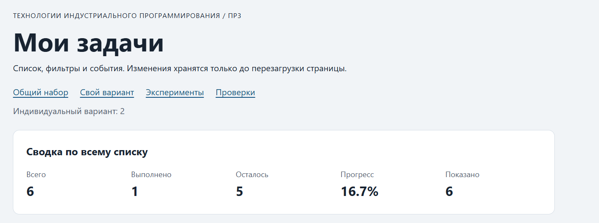

# Практическая работа № 3. Работа с DOM и событиями

## Данные работы

| Поле | Значение |
|---|---|
| Имя | Филиппов Кирилл |
| Группа | ЭФБО-13-25 |
| Вариант из ПР2 | № 2 — «Подготовка выступления» (номер по журналу 26) |
| Node.js | v24.14.0 |
| Браузер | Microsoft Edge 155.0.4283.45 |
| Операционная система | Windows 11 Home, версия 26H2, сборка 26300.9550 |

## Запуск

Рабочая папка: `practice-03` внутри личного репозитория `tip-js-practices`.

```bash
npm run check:service
npm start
```

Установка зависимостей через `npm install` не требуется. Адреса:

```text
http://127.0.0.1:5503/
http://127.0.0.1:5503/index.html?dataset=variant
http://127.0.0.1:5503/examples/dom-events.html
http://127.0.0.1:5503/checks.html
```

Остановка сервера: `Ctrl+C`.

## Что перенесено из ПР2

Из `practice-02/src/` в `practice-03/src/` скопированы собственные файлы `task-service.js` и `data.js`. В первом находятся проверенные функции для работы с задачами, во втором — общий набор и шесть задач индивидуального варианта. `main.js` из ПР2 не переносился, поскольку в ПР3 реализуется браузерный интерфейс.

**Результат повторной проверки сервиса:** `Проверок пройдено: 35; не пройдено: 0.` Полный вывод приведён в разделе «Протокол проверки сервиса».

## Эксперименты

| № | До запуска: прогноз | После запуска: результат | Объяснение |
|---:|---|---|---|
| 1. Отсутствующий элемент и коллекция | `querySelector` вернёт `null`, `querySelectorAll` — коллекцию длины 0 | `document.querySelector("#absent")` вернул `null`; `document.querySelectorAll(".absent").length` — `0`. | `querySelector` ищет один элемент, `querySelectorAll` возвращает коллекцию совпадений; обращение к свойству `null` вызывает ошибку. |
| 2. dataset и числовой id | `dataset.taskId` будет строкой; `Number()` вернёт число | `button.dataset.taskId` — `"23"`, тип `string`; после `Number()` — `23`, тип `number`. | Значения `data-*` читаются как строки, а функции сервиса ожидают числовой идентификатор. |
| 3. Статический NodeList | После двух добавлений ранее полученный `NodeList` не изменит длину, новый запрос увидит элементы | Исходная длина — `1`. После первого добавления: старый NodeList — `1`, новый запрос — `2`; после второго: `1` и `3`. | `querySelectorAll` возвращает статическую коллекцию. |
| 4. Строка с HTML-разметкой | `<strong>` будет показан как текст | Заголовок содержит буквальный текст `<strong>Это текст, а не HTML</strong>`; дочерних элементов — `0`. | `textContent` не интерпретирует строку как HTML. |
| 5. Распространение события | Будут видны захват, цель и всплытие | При клике на `span#lab-label`: `phase=1`, `currentTarget=lab-card` → `phase=3`, `currentTarget=lab-button` → `phase=3`, `currentTarget=lab-card`. Во всех записях `target=lab-label`. | `target` — исходный вложенный `span`; `currentTarget` — элемент текущего обработчика. Кнопка — предок `span`, поэтому её обработчик вызывается при всплытии. На самом `span` обработчика нет, фаза `2` в журнал не попадает. |

Результаты получены при запуске `examples/dom-events.html` в Microsoft Edge. Прогнозы подтвердились; в пятом эксперименте журнал фиксирует захват и два обработчика всплытия, поскольку на целевом `span` нет обработчика.

## Организация кода

- `task-service.js` — операции над массивом задач и `getTaskStats`, без обращений к DOM.
- `task-selectors.js` — `getVisibleTasks`, получение видимой выборки для `all`, `pending`, `completed`.
- `task-view.js` — создание карточек через DOM, перерисовка списка, сводка и пустые состояния.
- `main.js` — хранение `currentTasks` (полный массив) и `currentFilter`, обработка событий и вызов `renderApp()`.

Нажатие обрабатывается через делегирование событий в `handleTaskListClick()`. Для изменения статуса и удаления используются функции ПР2. Сводка вычисляется через `getTaskStats(currentTasks)`, а количество показанных задач — по длине отфильтрованной выборки.

## Общий сценарий

Сценарий выполнен в Microsoft Edge на общем наборе. Фактические значения совпали с контрольными. Последовательность действий:

0. Открыть приложение с общим набором.
1. Выбрать фильтр «В работе».
2. Переключить статус задачи `id = 4` на выполненный.
3. Вернуться к фильтру «Все».
4. Удалить задачу `id = 7`.
5. Выбрать фильтр «В работе».
6. Вернуться к фильтру «Все» и переключить задачу `id = 1` в работу.
7. Удалить оставшиеся задачи `id = 1`, `4`, `10`.

| Шаг | Видимые id | Всего | Выполнено | Осталось | Прогресс | Показано | Сообщение | Совпало с ожиданием |
|---:|---|---:|---:|---:|---|---:|---|---|
| 0 | 1, 4, 7, 10 | 4 | 2 | 2 | 50.0% | 4 | Нет | Да |
| 1 | 4, 7 | 4 | 2 | 2 | 50.0% | 2 | Нет | Да |
| 2 | 7 | 4 | 3 | 1 | 75.0% | 1 | Нет | Да |
| 3 | 1, 4, 7, 10 | 4 | 3 | 1 | 75.0% | 4 | Нет | Да |
| 4 | 1, 4, 10 | 3 | 3 | 0 | 100.0% | 3 | Нет | Да |
| 5 | — | 3 | 3 | 0 | 100.0% | 0 | Нет задач по выбранному фильтру. | Да |
| 6 | 1, 4, 10 | 3 | 2 | 1 | 66.7% | 3 | Нет | Да |
| 7 | — | 0 | 0 | 0 | 0.0% | 0 | Список задач пуст. | Да |

После повторной загрузки страницы восстановились задачи `id = 1, 4, 7, 10` и фильтр «Все». Сводка: всего `4`, выполнено `2`, осталось `2`, прогресс `50.0%`, показано `4`. Сообщение о пустом списке исчезло. Изменения хранятся в памяти и не сохраняются между загрузками.

## Индивидуальный вариант

**Вариант № 2 — «Подготовка выступления».** Исходные задачи:

| id | Название | Статус | Приоритет |
|---:|---|---|---|
| 11 | Выбрать тему выступления | Выполнена | Высокий |
| 23 | Составить план выступления | В работе | Средний |
| 37 | Подготовить презентацию | В работе | Высокий |
| 41 | Подобрать иллюстрации | В работе | Низкий |
| 58 | Проверить текст доклада | В работе | Средний |
| 64 | Провести репетицию | В работе | Высокий |

Таблица содержит фактические значения после запуска `index.html?dataset=variant`: переключить статус `id = 23`, затем удалить `id = 37` и проверить оба фильтра.

| Этап | Всего | Выполнено | Осталось | Прогресс | Видимые id |
|---|---:|---:|---:|---|---|
| До действий | 6 | 1 | 5 | 16.7% | 11, 23, 37, 41, 58, 64 |
| После переключения 23 | 6 | 2 | 4 | 33.3% | 11, 23, 37, 41, 58, 64 |
| После удаления 37 | 5 | 2 | 3 | 40.0% | 11, 23, 41, 58, 64 |
| Итог, фильтр «В работе» | 5 | 2 | 3 | 40.0% | 41, 58, 64 |
| Итог, фильтр «Выполненные» | 5 | 2 | 3 | 40.0% | 11, 23 |

**Фактическое подтверждение:** задача `23` стала выполненной, задача `37` удалена. Итоговая сводка — `5` задач, `2` выполнены, `3` в работе, прогресс `40.0%`. Фильтр «В работе» показывает `41, 58, 64` (показано `3`), «Выполненные» — `11, 23` (показано `2`). Сводка по всему списку при смене фильтра не меняется. Все значения совпали с ожидаемыми.

## Протокол проверки сервиса

Фактический полный вывод `npm run check:service`:

```text
> tip-js-practice-03@1.0.0 check:service
> node checks/service.checks.js

OK: 01. Создание задачи с явным приоритетом
OK: 02. Приоритет по умолчанию
OK: 03. Удаление краевых пробелов без изменения внутренних
OK: 04. Граничные длины названия и положительный безопасный id
OK: 05. Некорректные названия при создании
OK: 06. Некорректные идентификаторы при создании
OK: 07. Все допустимые приоритеты и отклонение недопустимых
OK: 08. Каждый вызов createTask возвращает новый объект
OK: 09. Поиск по id, а не по индексу
OK: 10. Отсутствующая задача и пустой массив при поиске
OK: 11. Поиск не преобразует строковый id в число
OK: 12. Получение невыполненных задач
OK: 13. Пустой список, все выполнены и все не выполнены
OK: 14. Названия в исходном порядке и пустой список
OK: 15. Сводка по общему набору
OK: 16. Сводка по пустому списку
OK: 17. Сводка: ничего не выполнено и выполнено всё
OK: 18. Процент остаётся числом без предварительного округления
OK: 19. Добавление в конец без изменения входного массива
OK: 20. Добавление в пустой список с приоритетом по умолчанию
OK: 21. Повторяющийся id отклоняется
OK: 22. Добавление не обходит проверки createTask
OK: 23. Изменение completed в обе стороны
OK: 24. completed принимает только boolean
OK: 25. Некорректный или отсутствующий id при изменении статуса
OK: 26. Повторная установка статуса создаёт новый результат
OK: 27. Переименование сохраняет остальные поля
OK: 28. Проверки названия при переименовании
OK: 29. Некорректный или отсутствующий id при переименовании
OK: 30. Удаление по id с сохранением порядка
OK: 31. Удаление единственной записи
OK: 32. Некорректный, отсутствующий id и удаление из пустого списка
OK: 33. Входные объекты не изменяются ни одной операцией
OK: 34. Общий сценарий и все промежуточные сводки
OK: 35. Работа с другим набором, без зависимости от demoTasks

Проверок пройдено: 35; не пройдено: 0.
```

## Протокол браузерных проверок

Страница `checks.html` повторно запущена в Microsoft Edge 155.0.4283.45 в автоматическом режиме без окна браузера. Все 36 проверок прошли. Полный фактический текст блока «Текстовый протокол»:

```text
OK: Фильтр all возвращает новый массив в исходном порядке
OK: Фильтр pending выбирает невыполненные задачи
OK: Фильтр completed выбирает выполненные задачи
OK: Все три фильтра работают с пустым списком
OK: Фильтрация не меняет входные записи и их порядок
OK: Карточка — li.task-card с числовым id в dataset
OK: Статус невыполненной карточки и aria-pressed согласованы
OK: Статус выполненной карточки и aria-pressed согласованы
OK: В карточке две обычные кнопки с вложенными подписями
OK: Все приоритеты отображаются по установленному словарю
OK: Название с разметкой отображается текстом
OK: Отрисовка списка создаёт карточки в исходном порядке
OK: Повторная отрисовка не накапливает карточки
OK: Контейнер списка и его обработчик сохраняются
OK: Отрисовка пустого массива очищает прежние карточки
OK: Сводка считается по всему списку, отдельно выводится Показано
OK: Пустая сводка не содержит NaN и Infinity
OK: Сообщение для полностью пустого списка
OK: Сообщение для пустого результата фильтра
OK: Появление карточек скрывает прежнее пустое состояние
OK: Приложение: начальный набор и сводка
OK: Приложение: фильтр срабатывает по клику на вложенный span
OK: Приложение: активный фильтр отмечен классом и aria-pressed
OK: Приложение: фильтрация не удаляет скрытые задачи
OK: Приложение: переключение по id, а не индексу массива
OK: Приложение: выполненная задача исчезает из фильтра В работе
OK: Приложение: удаление изменяет данные, а не только DOM
OK: Приложение: клик по названию не изменяет данные
OK: Приложение: после перерисовок одно нажатие — одно изменение
OK: Приложение: удаление всех записей и нулевая сводка
OK: Приложение: нет совпадений — не то же самое, что нет задач
OK: Приложение: неизвестный числовой id не меняет данные
OK: Приложение: id 4abc не превращается в 4
OK: Приложение: неизвестное действие игнорируется
OK: Приложение: после изменения сохраняется клавиатурный фокус
OK: Приложение: новая загрузка возвращает исходное состояние

Всего: 36. Пройдено: 36. Ошибок: 0.
```

## Собственные проверки

| № | Исходное состояние и действия | Ожидаемый результат | Фактический результат | Итог |
|---:|---|---|---|---|
| 1 | Исходный набор, дважды переключить статус задачи `id = 4` | Статус возвращается к исходному, общий массив содержит 4 задачи | Задача `4` снова «В работе»; видны `1, 4, 7, 10`. Всего `4`, выполнено `2`, осталось `2`, прогресс `50.0%`. | Пройдено |
| 2 | Последовательно удалить все задачи, затем выбрать «В работе» | Пустой список, статистика 0/0/0 и 0.0%, сообщение «Список задач пуст.» | Карточек нет; всего `0`, выполнено `0`, осталось `0`, прогресс `0.0%`, показано `0`. Выведено «Список задач пуст.». | Пройдено |
| 3 | Нажать на вложенный `span` кнопки статуса, затем переключить фильтры | Обработчик распознаёт действие, статус меняется один раз; повторный рендер не дублирует карточки | После клика на `span.action-label` задачи `4` выполнено `3`, осталось `1`, прогресс `75.0%`. После фильтров «В работе» → «Выполненные» → «Все» видны ровно `4` карточки: `1, 4, 7, 10`; статус задачи `4` остаётся выполненным. | Пройдено |

## Отладка и клавиатура

Место для точки останова: строка `const id = Number(card.dataset.taskId)` в `handleTaskListClick()` файла `src/main.js`. При клике на подпись кнопки статуса задачи `id = 4` зафиксированы следующие значения события; результат сервиса проверен отдельным вызовом `setTaskCompleted` с исходным набором:

- `event.target`: `<span class="action-label">Выполнена</span>` внутри кнопки задачи `4`.
- `event.currentTarget`: `<ul id="task-list" class="task-list" aria-label="Задачи">`, на котором установлен делегированный обработчик.
- `card.dataset.taskId`: `"4"`, тип `string`.
- `id` после `Number()`: `4`, тип `number`.
- `action`: `"toggle"`.
- Результат сервиса: `ok: true`, `tasks` — новый массив с id `1, 4, 7, 10`; у задачи `4` значение `completed: true`. Поля `error` нет. После рендера сводка — `4 / 3 / 1`, прогресс `75.0%`.

Проверка клавиатуры выполнена отправкой клавиш в Microsoft Edge:

- `Tab` переводит фокус по ссылкам и кнопкам; с кнопки статуса задачи `4` — на её кнопку «Удалить».
- `Enter` на кнопке статуса задачи `4` меняет её статус на выполненный: сводка `4 / 3 / 1`, прогресс `75.0%`. Фокус остаётся на новой кнопке статуса этой задачи после перерисовки.
- `Space` на той же кнопке возвращает задачу в работу: сводка `4 / 2 / 2`, прогресс `50.0%`; фокус сохраняется.
- `Enter` на кнопке «Удалить» удаляет задачу `4`; видны `1, 7, 10`, прогресс `66.7%`. Фокус переходит на активный фильтр «Все».
- При выполнении задачи `4` под фильтром «В работе» карточка исчезает; фокус переходит на активный фильтр «В работе».

Проверка некорректных ID: в DOM у карточки задачи `4` временно заменено значение `data-task-id`, затем нажата кнопка действия.

| Значение ID | Действие | Фактическое сообщение |
|---|---|---|
| `777` | Удаление | `Задача не найдена` |
| `777` | Переключение статуса | `Ошибка: задача не найдена` |
| `4abc` | Переключение статуса | `Ошибка: некорректный идентификатор задачи` |

Во всех случаях данные остались неизменными. После выбора фильтра «Все» восстановились карточки с id `1, 4, 7, 10`; сводка — всего `4`, выполнено `2`, осталось `2`, прогресс `50.0%`, показано `4`. Строка `4abc` преобразуется в `NaN` и отклоняется до вызова сервиса.

## Вид приложения



## Дополнительное задание

Дополнительное задание не выполнялось.

## Вывод

В ходе практической работы реализован интерфейс управления задачами на JavaScript с использованием DOM и делегирования событий. Отображение карточек отделено от изменения данных: операции выполняются через функции `task-service.js`, а DOM обновляется после получения нового массива. Проверены фильтрация, переключение статуса, удаление, пустые состояния, обработка некорректных идентификаторов и сохранение клавиатурного фокуса. Общий сценарий и индивидуальный вариант дали ожидаемые результаты. Проверка сервиса завершилась результатом 35/35, браузерные проверки — 36/36, ошибок нет. Эксперименты подтвердили строковый тип значений `dataset`, статичность NodeList, безопасный вывод через `textContent` и порядок распространения событий.
