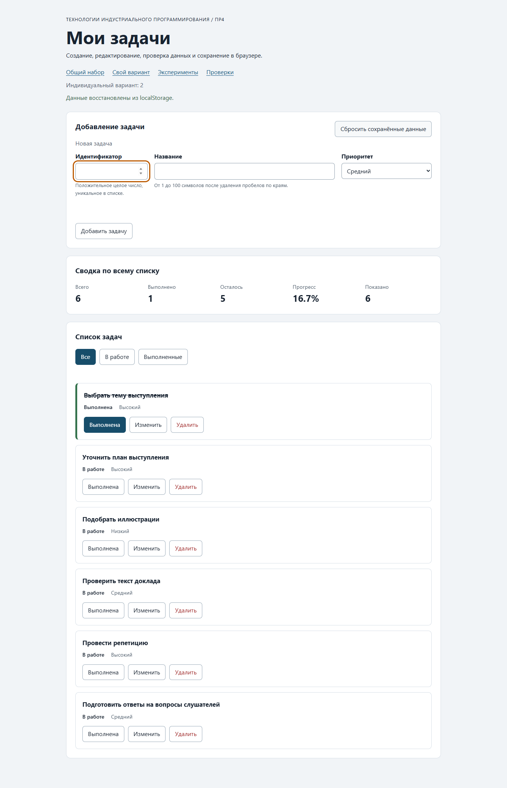

# Практическая работа № 4. Формы, валидация и локальное хранение данных

## Данные работы

| Поле | Значение |
|---|---|
| Автор | Филиппов Кирилл |
| Группа | ЭФБО-13-25 |
| Вариант | № 2, перенесён из ПР2–ПР3 |
| Дата проверки | 06.11.2026 |
| Node.js / npm | v24.14.0 / 11.9.0 |
| Git | 2.56.0.windows.1 |
| Браузер для проверки | Microsoft Edge 156.0.4314.58, headless, настоящий Chromium DOM |
| ОС | Windows 11 Home, 10.0.26300, сборка 26300 |

Основание: [задание ПР4](https://github.com/adyshkins/TIP-JS/blob/37fd64e6f09e728e60e6304d50eda07c398bbd1c/practices/practice-04/README.md).
Использованы серверы, разметка, оформление, примеры и проверки из стартового комплекта курса; прикладные функции реализованы в этой папке.
Решение: [practice-04 в личном репозитории](https://github.com/aka-rei/tip-js-practices/tree/main/practice-04).

## Запуск

Из папки `practice-04`:

```bash
npm test
npm start
```

Установка зависимостей не требуется. В PowerShell можно использовать `npm.cmd`.
Приложение: http://127.0.0.1:5504/; свой вариант: http://127.0.0.1:5504/?dataset=variant;
эксперименты: http://127.0.0.1:5504/examples/forms-storage.html; проверки: http://127.0.0.1:5504/checks.html.
Остановка сервера — Ctrl+C. Для другого порта: `node tools/serve.mjs 5514`.
Хранилища разных origin, включая разные порты и localhost/127.0.0.1, независимы.

## Перенос и организация кода

Из собственной ПР3 перенесены `data.js` (общие четыре и шесть задач варианта), `task-service.js`,
`task-selectors.js` и `task-view.js`. Старые 35 проверок сервиса проходят.
В сервис добавлена неизменяющая вход `updateTask`: общая проверка полей через `createTask`,
затем замена только title и priority; completed сохраняется.
В представление добавлена третья кнопка `edit` со вложенной подписью, пользовательский текст выводится через `textContent`.

`form-validation.js` проверяет все поля независимо, возвращает нормализованное значение или ошибки.
При редактировании id берётся из `editingId`: отключённый input не попадает в `FormData`.
`task-storage.js` проверяет версию, схему всего списка и уникальность id, сериализует JSON и перехватывает ошибки чтения/записи/удаления.
Передача storage аргументом позволяет подменять внешнюю зависимость в проверках.
Корректный синтаксис JSON сам по себе не подтверждает типы и версию данных.
`main.js` хранит состояние, режим формы, координирует сервис, хранение и отрисовку.
Фильтрация и рендер не пишут storage; успешные add/update/toggle/delete пишут.
При отказе записи данные остаются в памяти, пользователю показывается предупреждение.

Ключи: `tip-js-practice-04:demo`, `tip-js-practice-04:variant`.
Браузерные проверки используют отдельные ключи `tip-js-practice-04:checks:*`.
Сброс удаляет только текущий ключ и не записывает исходный набор обратно.

## Эксперименты с формой и JSON

| Эксперимент | Прогноз по коду | Фактический результат | Объяснение |
|---|---|---|---|
| Пустое required-поле | submit не возникнет | submitCount=0, validity.valid=false | Браузер проверяет ограничения до submit. |
| Только пробелы | required пропустит, trim отклонит | Название не должно состоять только из пробелов. | setCustomValidity задаёт прикладную ошибку; input очищает её. |
| Корректный ввод « Доклад » | Значения FormData — строки | defaultPrevented=true; title — string; сохранено «Доклад» | preventDefault отменяет стандартную отправку; trim нормализует. |
| Чтение записи | getItem вернёт строку | Строка {"title":"Доклад","priority":"low"}; JSON.parse вернул объект | Для хранения и восстановления нужны stringify/parse. |
| Повреждённый JSON | JSON.parse выбросит исключение | Expected property name or ... in JSON at position 1 | try/catch показывает ошибку и позволяет продолжить работу. |

Полные фактические значения: [scenarios.json](./reports/scenarios.json).

## Проверка формы

| Сценарий | Ожидание | Фактический результат |
|---|---|---|
| Корректная задача | Добавление и сохранение | Добавлена 20, после reload осталась |
| Повторный id=4 | Отказ без записи | Ошибка у id; JSON и список не изменились |
| Пустое название / пробелы | Отказ на соответствующем уровне | Нативная / прикладная проверка отклонила |
| 100 / 101 символ после trim | Успех / отказ | Подтверждено собственной проверкой, включая кириллицу |
| Редактирование | Меняются title и priority | id=4 изменён, completed=false сохранён; выполненная запись также сохраняет статус |
| Отмена редактирования | Пустая форма создания | id включён, ошибки сняты, фокус в id |

## Общий контрольный сценарий

Ожидаемые значения взяты из раздела 6.8 задания; каждый шаг совпал с ожиданием.

| Шаг | Видимые id | Всего | Выполнено | Осталось | Прогресс | Storage |
|---|---|---|---|---|---|---|
| 0: reset | 1, 4, 7, 10 | 4 | 2 | 2 | 50.0% | Ключ отсутствует |
| 1: add 20 | 1, 4, 7, 10, 20 | 5 | 2 | 3 | 40.0% | JSON version=1 |
| 2: duplicate 4 | 1, 4, 7, 10, 20 | 5 | 2 | 3 | 40.0% | JSON version=1 |
| 3: edit 4 | 1, 4, 7, 10, 20 | 5 | 2 | 3 | 40.0% | JSON version=1 |
| 4: toggle 7 | 1, 4, 7, 10, 20 | 5 | 3 | 2 | 60.0% | JSON version=1 |
| 5: delete 1 | 4, 7, 10, 20 | 4 | 2 | 2 | 50.0% | JSON version=1 |
| 6: reload | 4, 7, 10, 20 | 4 | 2 | 2 | 50.0% | JSON version=1 |
| 7: reset | 1, 4, 7, 10 | 4 | 2 | 2 | 50.0% | Ключ отсутствует |

## Восстановление и собственные проверки

| Случай | Ожидание | Фактический результат |
|---|---|---|
| Записи нет | Независимая копия исходного набора | source=initial, изменение копии не затрагивает fallback |
| Корректная запись и reload | Сохранённые изменения остаются | id 4,7,10,20, сводка 4/2/2, 50.0% |
| Повреждённый JSON | Исходный набор и предупреждение | Восстановлены 1,4,7,10; предупреждение показано |
| Неверная версия или схема | Отказ от всей записи | source=fallback; проверки модулей и браузера прошли |
| Сброс | Удалён только текущий ключ | Ключ отсутствует; другой набор не изменён |
| Ошибка getItem/setItem/removeItem | Управляемый отказ | ok=false с непустым error, исключение наружу не вышло |

Дополнительные сценарии в `checks/own.checks.js` выполняются командой `npm run check:own` и входят в `npm test`:

1. Название из 100 кириллических символов с краевыми пробелами принято; из 101 — отклонено.
2. Сохранённый пустой массив загружен как пустой, без подстановки fallback. Дополнительно удалены все карточки в браузере и выполнен настоящий reload: список и сводка остались нулевыми.
3. Валидный JSON с ненормализованным title отклонён целиком; fallback скопирован независимо от исходных объектов.

Все три собственные проверки прошли.

## Индивидуальный вариант

Исходные задачи: 11 — выбрать тему (выполнена, high); 23 — составить план (medium);
37 — подготовить презентацию (high); 41 — подобрать иллюстрации (low);
58 — проверить текст (medium); 64 — провести репетицию (high). Кроме 11 все в работе.
Добавлена 75 «Подготовить ответы на вопросы слушателей», medium;
у 23 название заменено на «Уточнить план выступления», приоритет high; 37 удалена.
Ожидание: после добавления и удаления шесть задач, одна выполнена, прогресс 16.7%.

| Этап | Всего | Выполнено | Осталось | Прогресс | Фактические id |
|---|---|---|---|---|---|
| initial | 6 | 1 | 5 | 16.7% | 11, 23, 37, 41, 58, 64 |
| add 75 | 7 | 1 | 6 | 14.3% | 11, 23, 37, 41, 58, 64, 75 |
| edit 23 | 7 | 1 | 6 | 14.3% | 11, 23, 37, 41, 58, 64, 75 |
| delete 37 | 6 | 1 | 5 | 16.7% | 11, 23, 41, 58, 64, 75 |
| reload | 6 | 1 | 5 | 16.7% | 11, 23, 41, 58, 64, 75 |
| reset | 6 | 1 | 5 | 16.7% | 11, 23, 37, 41, 58, 64 |

Общий набор после изменения варианта остался 1,4,7,10 с прогрессом 50.0%; сброс варианта вернул исходные шесть задач.

## Отладка и клавиатура

Через CDP Debugger в Microsoft Edge установлены реальные точки останова в `handleFormSubmit`
после `validateTaskDraft` и перед присваиванием `currentTasks = result.tasks`.

```json
[
  {
    "draft": {
      "id": "20",
      "title": " Изучить localStorage ",
      "priority": "high"
    },
    "validated": {
      "ok": true,
      "value": {
        "id": 20,
        "title": "Изучить localStorage",
        "priority": "high"
      }
    }
  },
  {
    "draft": {
      "id": "20",
      "title": " Изучить localStorage ",
      "priority": "high"
    },
    "validated": {
      "ok": true,
      "value": {
        "id": 20,
        "title": "Изучить localStorage",
        "priority": "high"
      }
    },
    "result": {
      "ok": true,
      "tasks": [
        {
          "id": 1,
          "title": "Изучить функции",
          "completed": true,
          "priority": "medium"
        },
        {
          "id": 4,
          "title": "Подготовить модель задач",
          "completed": false,
          "priority": "high"
        },
        {
          "id": 7,
          "title": "Проверить методы массивов",
          "completed": false,
          "priority": "low"
        },
        {
          "id": 10,
          "title": "Оформить README",
          "completed": true,
          "priority": "medium"
        },
        {
          "id": 20,
          "title": "Изучить localStorage",
          "completed": false,
          "priority": "high"
        }
      ]
    }
  },
  {
    "draft": {
      "id": "4",
      "title": "Повторный ID",
      "priority": "medium"
    },
    "validated": {
      "ok": false,
      "errors": {
        "id": "Задача с таким ID уже существует."
      }
    }
  }
]
```

Фактически записанная строка после успешного добавления:

```json
{"version":1,"tasks":[{"id":1,"title":"Изучить функции","completed":true,"priority":"medium"},{"id":4,"title":"Подготовить модель задач","completed":false,"priority":"high"},{"id":7,"title":"Проверить методы массивов","completed":false,"priority":"low"},{"id":10,"title":"Оформить README","completed":true,"priority":"medium"},{"id":20,"title":"Изучить localStorage","completed":false,"priority":"high"}]}
```

При повторном id валидация вернула ok=false, сервис и запись не вызывались.
Проверены Enter на отмене, Space на toggle, Tab между действиями:
начало редактирования фокусирует `task-title`, отмена — `task-id`, Space меняет aria-pressed на true,
Tab с toggle переходит на edit. После перерисовки фокус восстанавливается на действие или активный фильтр.

## Протоколы проверок

### Node.js: сервис, новые модули и собственные случаи

```text
> tip-js-practice-04@1.0.0 test
> npm run check:service && npm run check:modules && npm run check:own


> tip-js-practice-04@1.0.0 check:service
> node checks/service.checks.js

OK: 01. Создание задачи с явным приоритетом
OK: 02. Приоритет по умолчанию
OK: 03. Удаление краевых пробелов без изменения внутренних
OK: 04. Граничные длины названия и положительный безопасный id
OK: 05. Некорректные названия при создании
OK: 06. Некорректные идентификаторы при создании
OK: 07. Все допустимые приоритеты и отклонение недопустимых
OK: 08. Каждый вызов createTask возвращает новый объект
OK: 09. Поиск по id, а не по индексу
OK: 10. Отсутствующая задача и пустой массив при поиске
OK: 11. Поиск не преобразует строковый id в число
OK: 12. Получение невыполненных задач
OK: 13. Пустой список, все выполнены и все не выполнены
OK: 14. Названия в исходном порядке и пустой список
OK: 15. Сводка по общему набору
OK: 16. Сводка по пустому списку
OK: 17. Сводка: ничего не выполнено и выполнено всё
OK: 18. Процент остаётся числом без предварительного округления
OK: 19. Добавление в конец без изменения входного массива
OK: 20. Добавление в пустой список с приоритетом по умолчанию
OK: 21. Повторяющийся id отклоняется
OK: 22. Добавление не обходит проверки createTask
OK: 23. Изменение completed в обе стороны
OK: 24. completed принимает только boolean
OK: 25. Некорректный или отсутствующий id при изменении статуса
OK: 26. Повторная установка статуса создаёт новый результат
OK: 27. Переименование сохраняет остальные поля
OK: 28. Проверки названия при переименовании
OK: 29. Некорректный или отсутствующий id при переименовании
OK: 30. Удаление по id с сохранением порядка
OK: 31. Удаление единственной записи
OK: 32. Некорректный, отсутствующий id и удаление из пустого списка
OK: 33. Входные объекты не изменяются ни одной операцией
OK: 34. Общий сценарий и все промежуточные сводки
OK: 35. Работа с другим набором, без зависимости от demoTasks

Проверок пройдено: 35; не пройдено: 0.

> tip-js-practice-04@1.0.0 check:modules
> node checks/modules.checks.js

OK: 01. updateTask изменяет название и приоритет выбранной задачи
OK: 02. updateTask нормализует название и сохраняет completed
OK: 03. updateTask не изменяет входной массив и объекты
OK: 04. updateTask отклоняет некорректный и отсутствующий id
OK: 05. updateTask отклоняет некорректные название и приоритет
OK: 06. Валидация создания нормализует поля
OK: 07. Валидация отклоняет некорректные id
OK: 08. Валидация отклоняет повторяющийся id при создании
OK: 09. Валидация проверяет название после trim
OK: 10. Валидация принимает только три приоритета
OK: 11. В режиме редактирования используется editingId
OK: 12. Редактирование отсутствующей задачи отклоняется
OK: 13. Валидация не изменяет draft и список
OK: 14. Проверка схемы принимает корректный список
OK: 15. Проверка схемы отклоняет неверную структуру
OK: 16. Отсутствующая запись возвращает независимую копию исходных данных
OK: 17. Корректная запись восстанавливается из хранилища
OK: 18. Повреждённый JSON приводит к безопасному fallback
OK: 19. Неизвестная версия приводит к безопасному fallback
OK: 20. Некорректные задачи из JSON не принимаются
OK: 21. Ошибка getItem перехватывается
OK: 22. Сохранение записывает версию и задачи
OK: 23. Некорректный список не записывается
OK: 24. Ошибка setItem перехватывается
OK: 25. Удаляется только переданный ключ
OK: 26. Ошибка removeItem перехватывается
OK: 27. Результат загрузки не разделяет объекты с fallback

Проверок пройдено: 27; не пройдено: 0.

> tip-js-practice-04@1.0.0 check:own
> node checks/own.checks.js

OK: граница 100/101 символ после trim для кириллицы
OK: сохранённый пустой список восстанавливается, исходные задачи не возвращаются
OK: ненормализованная запись отклоняется целиком; fallback независим
Собственные проверки: 3/3.
```

### Браузер

```text
OK: Фильтры ПР3 сохраняют порядок и не изменяют вход
OK: Карточка содержит toggle, edit и delete
OK: Название задачи выводится как текст
OK: Повторная отрисовка списка не накапливает карточки
OK: Сводка использует полный список и отдельный visibleCount
OK: Пустые состояния различают список и фильтр
OK: Приложение запускается с исходным набором
OK: Корректная форма добавляет задачу и сохраняет данные
OK: Повторяющийся id отклоняется без записи
OK: Название из пробелов отклоняется прикладной проверкой
OK: Нативные ограничения не пропускают пустую форму
OK: Кнопка edit заполняет форму и блокирует id
OK: Редактирование меняет title и priority, сохраняя completed
OK: Отмена редактирования возвращает режим создания
OK: Успешная отправка очищает ошибки и форму
OK: Изменение статуса сохраняется
OK: Удаление сохраняется
OK: Фильтр не записывается, но сохраняется после изменения данных
OK: Перезагрузка восстанавливает сохранённые задачи
OK: Сброс удаляет ключ и восстанавливает исходный набор
OK: Повреждённый JSON не ломает запуск
OK: Некорректная схема из storage заменяется исходным набором
OK: Общий и индивидуальный наборы используют разные ключи

Всего: 23. Пройдено: 23. Ошибок: 0.
```

## Вид приложения



## Дополнительное задание

Черновик формы и синхронизация вкладок не выполнялись; реализована вся обязательная часть.

## Вывод

Приложение создаёт и редактирует задачи, сохраняет успешные изменения и безопасно восстанавливает данные.
HTML проверяет базовые ограничения, чистая валидация — правила предметной области, storage — схему сохранённого JSON.
Ошибки формы не изменяют список, ошибки хранения не мешают работе с данными в памяти.
