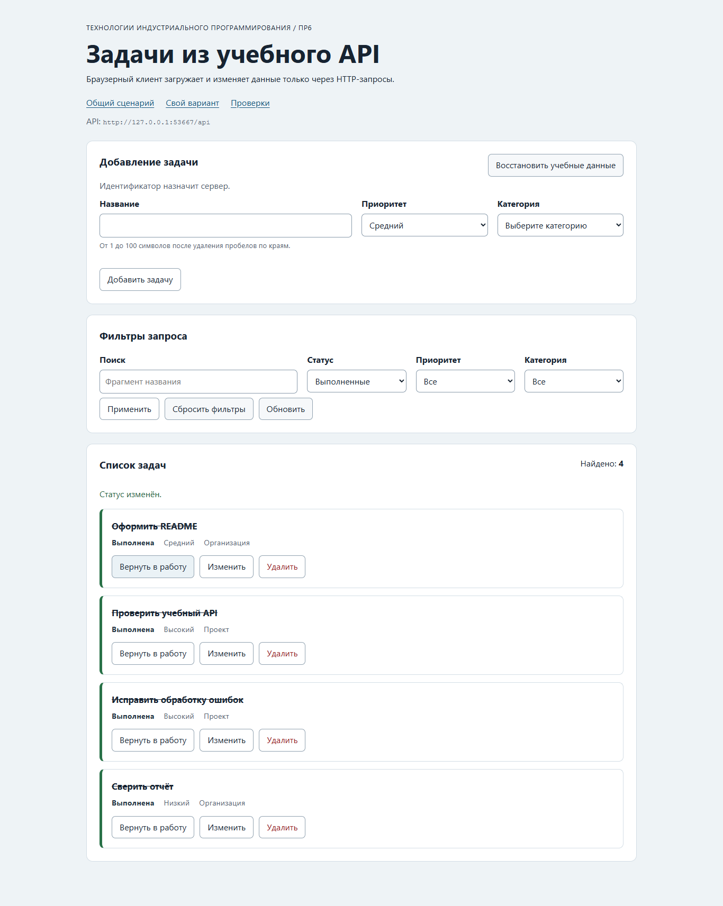

# Практическая работа № 6. Браузерный клиент HTTP API

## Данные работы

| Поле | Значение |
|---|---|
| Автор | Филиппов Кирилл |
| Группа | ЭФБО-13-25 |
| Вариант | № 2, перенесён из ПР2–ПР3 |
| Дата проверки | 06.11.2026 |
| Node.js / npm | v24.14.0 / 11.9.0 |
| Git | 2.56.0.windows.1 |
| Браузер для проверки | Microsoft Edge 156.0.4314.58, headless, настоящий Chromium DOM |
| ОС | Windows 11 Home, 10.0.26300, сборка 26300 |

Основание: [задание ПР6](https://github.com/adyshkins/TIP-JS/blob/37fd64e6f09e728e60e6304d50eda07c398bbd1c/practices/practice-06/README.md).
Использованы серверы, разметка, оформление, примеры и проверки из стартового комплекта курса; прикладные функции реализованы в этой папке.
Решение: [practice-06 в личном репозитории](https://github.com/aka-rei/tip-js-practices/tree/main/practice-06).

## Запуск

Из `practice-06`:

```bash
npm test
npm start
```

Установка зависимостей не требуется. `npm start` запускает оба сервера:
приложение http://127.0.0.1:5506/, API http://127.0.0.1:5505/api.
Вариант № 2: http://127.0.0.1:5506/?dataset=variant; проверки: http://127.0.0.1:5506/checks.html.
Ctrl+C останавливает оба сервера. Если API ПР5 занимает 5505, его необходимо остановить.
Другие порты: `node tools/start.mjs 5515 5516`, затем http://127.0.0.1:5516/?api=http://127.0.0.1:5515/api.
Браузерные checks.html используют API на стандартном порту 5505.

## Реализация

Из проверенного решения ПР5 перенесены `api-client.js` и `task-api.js`.
Общий клиент поддерживает GET/POST/PATCH/DELETE, переводит метод в верхний регистр,
отклоняет body у GET, сериализует JSON и добавляет Content-Type только при наличии тела.
Сохраняются Accept, тайм-аут, внешний AbortSignal, проверка Response и виды ошибок.
HTTP-статус обрабатывается до формата успешного ответа; 204 преобразуется в null без JSON.parse.

Предметный API проверяет фильтры и id до запроса, схему каждой полученной задачи/категории и коллекции после ответа.
Добавлены createTask (POST), updateTask и setTaskCompleted (PATCH), deleteTask (DELETE), resetDemoData (POST /debug/reset).
Удаление требует строго null; reset — подтверждение reset=true и неотрицательный целый total.
Все функции принимают options с signal. loadInitialData параллельно загружает задачи и категории.

Чистая валидация формы нормализует title, проверяет длину 1–100, допустимый приоритет и наличие categoryId
в загруженных категориях. Идентификатор и начальный completed назначает сервер.
Карточки создаются через DOM, строки выводятся через textContent, replaceChildren убирает старые карточки.

Контроллер хранит задачи, категории, фильтры, editingId и состояние загрузки.
DOM доступен только адаптеру `dom-app.js`; запросы идут через предметный API.
Первая загрузка использует loadInitialData, следующие — getTasks; повтор после неудачной первой загрузки снова получает категории.
Состояния списка: loading (aria-busy), ready, empty и error с кнопкой повторной загрузки.
При ошибке старые карточки очищаются; empty означает успешную пустую выборку.

Все мутации проходят через общий обработчик: блокировка, запрос, сообщение, повторный GET с текущими фильтрами, снятие блокировки.
Неудачная мутация не очищает введённую форму. Успешное создание/редактирование очищает её;
удаление редактируемой записи выходит из режима редактирования.
Сервер остаётся источником истины; localStorage не используется.

Новая загрузка отменяет старую через AbortController и увеличивает номер запроса.
Перед отрисовкой проверяются номер и сигнал, поэтому поздний ответ не изменит интерфейс,
даже если транспорт проигнорировал отмену. aborted не показывается как пользовательская ошибка.
destroy отменяет активную загрузку и запрещает поздние изменения представления.
Повторный submit блокируется и в контроллере, и в интерфейсе.

## Индивидуальный вариант

В `src/variant.js` задано variantNumber=2. Начальный фильтр `{ completed: true }`.
Ожидание: вернуть выполненную задачу 1 в работу; после повторного GET она исчезнет из текущей выборки.

| Этап | Ожидаемые id | Фактические id |
|---|---|---|
| Начальный GET /tasks?completed=true | 1,10,16,25,31 | 1,10,16,25,31 |
| PATCH /tasks/1 {completed:false}, затем GET | 10,16,25,31 | 10,16,25,31 |

Сценарий выполнен с отдельным экземпляром того же API на свободном порту, указанном в параметре api.

## Проверки в браузере

Следующие действия выполнены автоматизированно в настоящем Microsoft Edge через браузерный интерфейс,
а не заменены вызовами DOM-имитации. Протокол: [scenarios.json](./reports/scenarios.json).

| Сценарий | Ожидание | Фактический результат |
|---|---|---|
| API остановлен | error и кнопка повтора | Сообщение о недоступном соединении, retry видна |
| Запустить API и повторить | ready и категории | 12 задач; форма и фильтр получили категории |
| Поиск без совпадений | empty без старых карточек | kind=empty, total=0 |
| Неверная форма | Нет POST, ошибка у поля | Ноль POST, aria-invalid и сообщение title |
| Создать задачу и обновить страницу | Запись сохраняется на сервере | id=35 остался после reload, 13 задач |
| Изменить выполненную задачу | completed сохраняется | id=10 остался task-card is-completed |
| Смена статуса при фильтре | Карточка исчезает | Вариант № 2: id=1 исчез, четыре записи |
| Отказ от подтверждения удаления | Запись остаётся | id=7 сохранён |
| Два фильтра при задержке сети 200 мс | Результат последнего запроса | После q=функции и q=Promise виден только id=13 |
| reset | Исходные 12 задач | Контрольный порядок восстановлен |
| Перезапустить API | Исходный набор | id=35 отсутствует, снова 12 задач |

В готовой браузерной проверке курса исправлено только ожидание создания:
в callback ожидания `requireNode` бросал исключение до завершения POST/GET, поэтому заменён на `querySelector`.
Ожидаемые id, заголовок, очистка формы, количество и тайм-аут сохранены.
Готовые сервер, данные и остальные проверочные сценарии не менялись под реализацию.

## Собственные проверки

`checks/own.checks.js` входит в npm test. Два случая сверх готового набора:

1. Пока создание не завершено, второй submit не вызывает API: ровно один createTask.
2. После destroy сигнал отменён; даже успешный поздний ответ не вызывает setTasks или notify.

Оба сценария прошли. При браузерной проверке дополнительно подтверждена гонка запросов с задержкой сети.

## Фактический протокол Node.js

```text
> tip-js-practice-06@1.0.0 test
> npm run check:api && npm run check:modules && npm run check:integration && npm run check:own


> tip-js-practice-06@1.0.0 check:api
> node checks/api-server.checks.js

OK: 01. health возвращает JSON и заголовки CORS
OK: 02. исходный список содержит 12 задач в контрольном порядке
OK: 03. фильтры и поиск применяются совместно
OK: 04. неверный или повторяющийся query даёт 400
OK: 05. POST создаёт задачу, обрезает title и назначает id
OK: 06. созданная задача доступна по id и в списке
OK: 07. POST требует application/json
OK: 08. повреждённый JSON даёт структурированную ошибку
OK: 09. серверная валидация сообщает ошибки полей
OK: 10. PATCH изменяет только переданные поля
OK: 11. PATCH изменяет completed логическим значением
OK: 12. пустой PATCH и неизвестное поле отклоняются
OK: 13. DELETE возвращает 204 без тела
OK: 14. отсутствующая задача даёт 404 для PATCH и DELETE
OK: 15. неверный id даёт 400
OK: 16. категории доступны отдельным ресурсом
OK: 17. HEAD возвращает заголовки без тела
OK: 18. OPTIONS объявляет CORS для изменяющих методов
OK: 19. неподдерживаемый метод даёт 405 и Allow
OK: 20. отладочные маршруты воспроизводят виды ошибок
OK: 21. слишком большое тело запроса отклоняется
OK: 22. reset восстанавливает данные и счётчик id
OK: 23. два экземпляра API не делят изменяемое состояние

Итог API: успешно 23, ошибок 0.

> tip-js-practice-06@1.0.0 check:modules
> node checks/modules.checks.js

OK: 01. buildUrl соединяет baseUrl, путь и кодированный query
OK: 02. buildUrl не изменяет объект query
OK: 03. createApiClient проверяет конфигурацию
OK: 04. GET отправляет Accept, query и AbortSignal
OK: 05. POST сериализует тело и добавляет Content-Type
OK: 06. PATCH поддерживается, а неизвестный метод и body у GET отклоняются
OK: 07. успешный 204 преобразуется в null
OK: 08. JSON-ошибка HTTP сохраняет поля контракта
OK: 09. HTTP-ошибка важнее неверного Content-Type
OK: 10. неверный Content-Type и повреждённый JSON отклоняются
OK: 11. сетевая ошибка сохраняется как cause
OK: 12. тайм-аут отличается от внешней отмены
OK: 13. createTaskApi требует requestJson
OK: 14. getTasks нормализует фильтры и проверяет ответ
OK: 15. getTasks отклоняет неверные фильтры до запроса
OK: 16. loadInitialData параллельно запрашивает задачи и категории
OK: 17. createTask отправляет POST и проверяет задачу
OK: 18. update и смена статуса отправляют PATCH
OK: 19. deleteTask требует ответ 204, reset проверяет подтверждение
OK: 20. доменный API отклоняет неверную схему ответа
OK: 21. validateTaskDraft нормализует корректные данные
OK: 22. validateTaskDraft возвращает ошибки каждого поля
OK: 23. контроллер проверяет зависимости
OK: 24. start отображает loading, категории, задачи и ready
OK: 25. пустой ответ отображает состояние empty
OK: 26. ошибка загрузки отображается, а aborted не показывается
OK: 27. новая загрузка отменяет предыдущую и игнорирует устаревший ответ
OK: 28. невалидная форма не вызывает API
OK: 29. создание блокирует действия, очищает форму и обновляет список
OK: 30. редактирование, toggle и delete используют id текущей задачи
OK: 31. ошибка мутации показывается и снимает блокировку
OK: 32. reset вызывает сервер и перезагружает текущий фильтр
OK: 33. messageForError не раскрывает внутреннюю ошибку

Итог модулей: успешно 33, ошибок 0.

> tip-js-practice-06@1.0.0 check:integration
> node checks/integration.checks.js

OK: 01. начальная загрузка получает задачи и категории
OK: 02. клиент создаёт задачу и получает назначенный id
OK: 03. созданная задача читается по id
OK: 04. редактирование сохраняется на сервере
OK: 05. созданная задача находится серверным поиском
OK: 06. смена статуса видна через фильтр
OK: 07. DELETE удаляет запись и возвращает null
OK: 08. повторное удаление сохраняет код и детали 404
OK: 09. серверная ошибка валидации доступна клиенту
OK: 10. 204 не вызывает ошибку разбора JSON
OK: 11. реальная задержка прерывается по тайм-ауту
OK: 12. внешний AbortController отменяет реальный запрос
OK: 13. повреждённый JSON и text/plain определяются как invalid-response
OK: 14. reset восстанавливает исходный набор

Итог интеграции: успешно 14, ошибок 0.

> tip-js-practice-06@1.0.0 check:own
> node checks/own.checks.js

OK: два быстрых submit создают ровно один запрос
OK: destroy отменяет загрузку и игнорирует поздний успешный ответ
Собственные проверки: 2/2.
```

## Фактический протокол браузера

```text
OK: Карточка содержит безопасный текст и три действия
OK: Повторная отрисовка списка не накапливает карточки
OK: Начальная загрузка показывает 12 задач и 3 категории
OK: Фильтры формируют новый серверный запрос
OK: Поиск без результатов показывает empty, а сброс возвращает список
OK: Корректная форма создаёт задачу с серверным id
OK: Ошибки формы не отправляют запрос и связаны с полями
OK: Редактирование заполняет форму и сохраняет изменения
OK: Отмена редактирования возвращает режим создания
OK: Смена статуса подтверждается сервером
OK: Удаление подтверждается и сохраняется на сервере
OK: Сброс восстанавливает учебный набор
OK: Недоступный API показывает error и кнопку повтора
OK: Приложение не использует localStorage как источник данных

Всего: 14. Пройдено: 14. Ошибок: 0.
```

## Контрольные вопросы

1. **Почему fetch не отклоняет Promise при 404?** Ответ сервера получен; приложение само проверяет response.ok и преобразует статус в HTTP-ошибку.
2. **Почему нельзя разбирать 204 через response.json()?** У ответа нет JSON-тела; разбор пустой строки завершится ошибкой.
3. **Чем empty отличается от error?** empty — успешный запрос без совпадений; error — данные получить не удалось.
4. **Зачем отменять предыдущий запрос?** Чтобы прекратить лишнюю работу. Номер загрузки дополнительно защищает от поздних ответов транспорта, который не успел отмениться.
5. **Почему после мутации выполняется GET?** Сервер назначает id, нормализует данные и применяет текущие фильтры; повторное чтение подтверждает фактическое состояние.

## Вид приложения



## Ограничения и дополнительные задания

API хранит один общий учебный набор в памяти, перезапуск восстанавливает исходные данные.
Авторизация, база данных, пагинация и оптимистическое обновление не входят в обязательный объём и не добавлялись.

## Вывод

Браузерный интерфейс связан с HTTP API через общий и предметный клиенты.
Создание, редактирование, статус, удаление и сброс подтверждаются сервером.
Валидация, состояния ошибки/пустой выборки и защита от устаревших ответов проверены отдельно и в браузере.
